<!-- diagram-contract: node_seam_read_orchestrator:graph collapsed -->
```mermaid
flowchart TB
    backlog["Backlog (source)"]
    st01_fill["St1 Fill"]
    st02_brief["St2 Brief"]
    st03_runner["St3 Runner"]
    st04_placement["St4 Placement"]
    st05_lane_run["St5 Lane run"]
    st06_commit_push["St6 Commit and push"]
    st07_handoff["St7 Handoff"]
    st08_landing_controller["St8 Landing controller"]
    st09_ci["St9 CI"]
    st10_merge["St10 Merge"]
    st11_plugin_bump_release["St11 Plugin bump and release"]
    st12_deploy["St12 Deploy"]
    st13_adoption_running["St13 Adoption and running"]
    sm_13_adoption_to_running("SM-13 adoption to running")
    st13_adoption_running --> sm_13_adoption_to_running
    backlog -- "SM-00 backlog to fill" --> st01_fill
    st01_fill -- "SM-01 fill to brief" --> st02_brief
    st02_brief -- "SM-02 brief to runner" --> st03_runner
    st03_runner -- "SM-03 runner to placement" --> st04_placement
    st04_placement -- "SM-04 placement to lane run" --> st05_lane_run
    st05_lane_run -- "SM-05 lane run to commit and push" --> st06_commit_push
    st06_commit_push -- "SM-06 commit and push to handoff" --> st07_handoff
    st07_handoff -- "SM-07 handoff to controller" --> st08_landing_controller
    st08_landing_controller -- "SM-08 controller to CI" --> st09_ci
    st09_ci -- "SM-09 CI to merge" --> st10_merge
    st10_merge -- "SM-10 merge to release" --> st11_plugin_bump_release
    st11_plugin_bump_release -- "SM-11 release to deploy" --> st12_deploy
    st12_deploy -- "SM-12 deploy to adoption" --> st13_adoption_running
```
*Figure 1. The factory line, stations as boxes and seams as labelled arrows. It renders the `execution_graph` of the `node_seam_read_orchestrator` contract (fragment in section 2.4), collapsed view: each seam reading is drawn as the label of the arrow between its two stations. The last seam, SM-13, has no station after it, so it is drawn as its own node.*

<!-- diagram-contract: node_andon_stop_reducer:state_machine -->
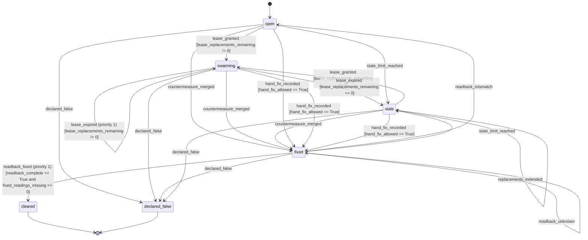
*Figure 2. The life of one andon stop. It renders the `state_machine` of the `node_andon_stop_reducer` contract (fragment in section 5.8). An arrow reads: from state, to state, the event that causes it, the priority if it is not the lowest, and the guards in square brackets.*

<!-- diagram-contract: node_wip_gate_reducer:state_machine -->
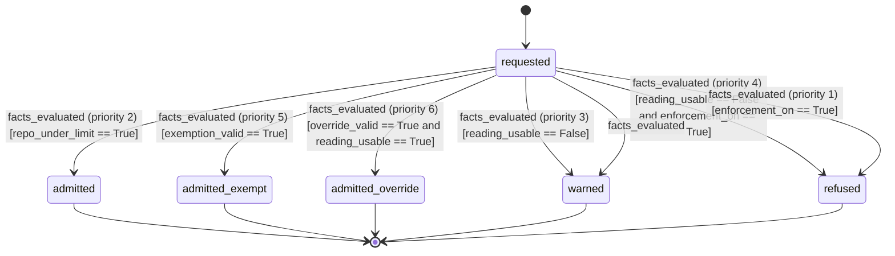
*Figure 3. The gate's decision on one request to open a pull request in a repository. It renders the `state_machine` of the `node_wip_gate_reducer` contract (fragment in section 6.7). Arrows are tried from the highest priority down and the first whose guards hold is taken.*

<!-- diagram-contract: node_slot_assignment_reducer:state_machine -->
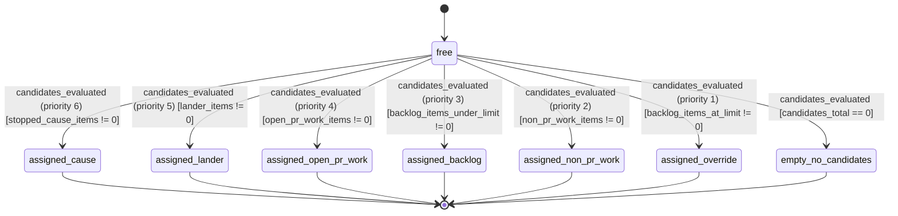
*Figure 4. What one free lab slot takes, in pull-first order. It renders the `state_machine` of the `node_slot_assignment_reducer` contract (fragment in section 6.7). The only way to reach `empty_no_candidates` is a candidate total of zero: no arrow into it mentions a WIP limit, which is how the contract says a limit can never idle the lab.*

<!-- diagram-contract: node_binding_parity_orchestrator:graph -->
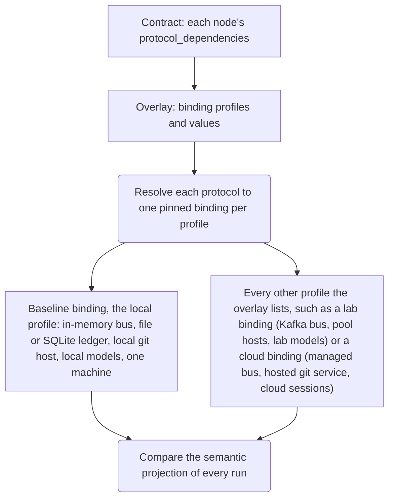
*Figure 9. The binding layers. It renders the `execution_graph` of the `node_binding_parity_orchestrator` contract (fragment below). Rounded boxes are pure steps; square boxes touch the world. The contract names two roles, the baseline and the others, and never a profile id; nothing above the bindings knows which one is in use.*

<!-- contract-fragment: node_binding_parity_orchestrator:graph -->
```yaml
workflow_coordination:
  workflow_definition:
    workflow_metadata:
      workflow_name: binding_parity
      workflow_version: {major: 1, minor: 0, patch: 0}
      description: Run one scenario under the baseline profile and under every other profile the overlay lists, then compare the semantic projection of the runs.
    execution_graph:
      nodes:
      - {node_id: contract, node_type: EFFECT_GENERIC, description: 'Contract: each node''s protocol_dependencies'}
      - node_id: overlay
        node_type: EFFECT_GENERIC
        description: 'Overlay: binding profiles and values'
        depends_on: [contract]
      - node_id: resolve
        node_type: COMPUTE_GENERIC
        description: Resolve each protocol to one pinned binding per profile
        depends_on: [overlay]
        step_config: {operation: resolve_profile_bindings}
      - node_id: run_baseline
        node_type: EFFECT_GENERIC
        description: 'Baseline binding, the local profile: in-memory bus, file or SQLite ledger, local git host, local models, one machine'
        depends_on: [resolve]
        step_config: {operation: run_scenario, profile_role: baseline}
      - node_id: run_others
        node_type: EFFECT_GENERIC
        description: 'Every other profile the overlay lists, such as a lab binding (Kafka bus, pool hosts, lab models) or a cloud binding (managed bus, hosted git service, cloud sessions)'
        depends_on: [resolve]
        step_config: {operation: run_scenario, profile_role: each_other}
      - node_id: parity
        node_type: COMPUTE_GENERIC
        description: Compare the semantic projection of every run
        depends_on: [run_baseline, run_others]
        step_config: {operation: compare_runs}
```

<!-- diagram-contract: node_lane_lease_reducer:state_machine -->
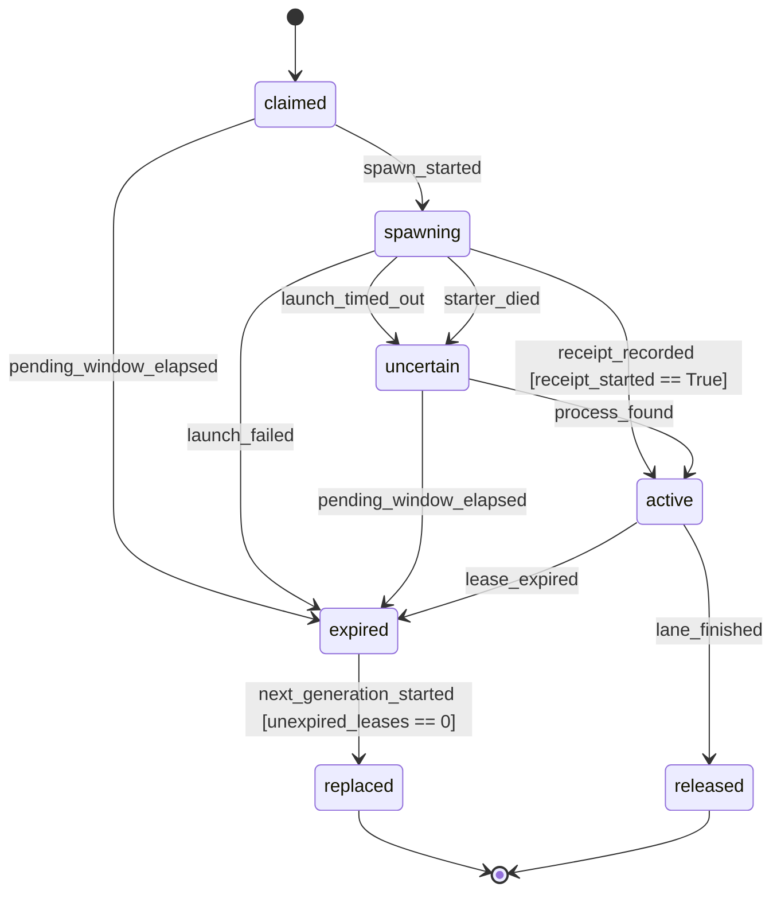
*Figure 10. The life of one lane lease. It renders the `state_machine` of the `node_lane_lease_reducer` contract (fragment below). An expired lease has no write authority, whether or not its process still runs and whether or not a replacement ever starts.*

<!-- contract-fragment: node_lane_lease_reducer:state_machine -->
```yaml
state_machine:
  version: {major: 1, minor: 0, patch: 0}
  state_machine_name: lane_lease_fsm
  state_machine_version: {major: 1, minor: 0, patch: 0}
  description: 'Lifecycle of one lane lease: claimed, spawning, uncertain after a starter crash, active, expired and fenced, replaced or released.'
  initial_state: claimed
  terminal_states: [replaced, released]
  error_states: []
  persistence_enabled: false
  states:
  - version: {major: 1, minor: 0, patch: 0}
    state_name: claimed
    state_type: operational
    description: The key is claimed; no process has been registered.
  - version: {major: 1, minor: 0, patch: 0}
    state_name: spawning
    state_type: operational
    description: A keyed process token is registered and the lane is being created.
  - version: {major: 1, minor: 0, patch: 0}
    state_name: uncertain
    state_type: operational
    description: The starter died while spawning; whether a process exists is not known and the host pool must reconcile it.
  - version: {major: 1, minor: 0, patch: 0}
    state_name: active
    state_type: operational
    description: The lane holds the lease and may write.
  - version: {major: 1, minor: 0, patch: 0}
    state_name: expired
    state_type: operational
    description: The lease ran out or the start never completed; write authority is gone and a live old process is fenced.
  - version: {major: 1, minor: 0, patch: 0}
    state_name: replaced
    state_type: terminal
    description: The next generation started.
    is_terminal: true
    is_recoverable: false
  - version: {major: 1, minor: 0, patch: 0}
    state_name: released
    state_type: terminal
    description: The lane finished and released its lease.
    is_terminal: true
    is_recoverable: false
  transitions:
  - version: {major: 1, minor: 0, patch: 0}
    transition_name: claimed_to_spawning_on_spawn_started
    from_state: claimed
    to_state: spawning
    trigger: spawn_started
  - version: {major: 1, minor: 0, patch: 0}
    transition_name: claimed_to_expired_on_pending_window_elapsed
    from_state: claimed
    to_state: expired
    trigger: pending_window_elapsed
  - version: {major: 1, minor: 0, patch: 0}
    transition_name: spawning_to_active_on_receipt_recorded
    from_state: spawning
    to_state: active
    trigger: receipt_recorded
    conditions:
    - {condition_name: receipt_started, condition_type: expression, expression: receipt_started == True}
  - version: {major: 1, minor: 0, patch: 0}
    transition_name: spawning_to_expired_on_launch_failed
    from_state: spawning
    to_state: expired
    trigger: launch_failed
  - version: {major: 1, minor: 0, patch: 0}
    transition_name: spawning_to_uncertain_on_launch_timed_out
    from_state: spawning
    to_state: uncertain
    trigger: launch_timed_out
  - version: {major: 1, minor: 0, patch: 0}
    transition_name: spawning_to_uncertain_on_starter_died
    from_state: spawning
    to_state: uncertain
    trigger: starter_died
  - version: {major: 1, minor: 0, patch: 0}
    transition_name: uncertain_to_active_on_process_found
    from_state: uncertain
    to_state: active
    trigger: process_found
  - version: {major: 1, minor: 0, patch: 0}
    transition_name: uncertain_to_expired_on_pending_window_elapsed
    from_state: uncertain
    to_state: expired
    trigger: pending_window_elapsed
  - version: {major: 1, minor: 0, patch: 0}
    transition_name: active_to_expired_on_lease_expired
    from_state: active
    to_state: expired
    trigger: lease_expired
  - version: {major: 1, minor: 0, patch: 0}
    transition_name: active_to_released_on_lane_finished
    from_state: active
    to_state: released
    trigger: lane_finished
  - version: {major: 1, minor: 0, patch: 0}
    transition_name: expired_to_replaced_on_next_generation_started
    from_state: expired
    to_state: replaced
    trigger: next_generation_started
    conditions:
    - {condition_name: no_unexpired_lease, condition_type: expression, expression: unexpired_leases == 0}
```

<!-- diagram-contract: node_seam_read_orchestrator:graph -->
```mermaid
flowchart TB
    backlog["Backlog (source)"]
    sm_00_backlog_to_fill("SM-00 backlog to fill")
    st01_fill["St1 Fill"]
    sm_01_fill_to_brief("SM-01 fill to brief")
    st02_brief["St2 Brief"]
    sm_02_brief_to_runner("SM-02 brief to runner")
    st03_runner["St3 Runner"]
    sm_03_runner_to_placement("SM-03 runner to placement")
    st04_placement["St4 Placement"]
    sm_04_placement_to_lane_run("SM-04 placement to lane run")
    st05_lane_run["St5 Lane run"]
    sm_05_lane_run_to_commit("SM-05 lane run to commit and push")
    st06_commit_push["St6 Commit and push"]
    sm_06_commit_to_handoff("SM-06 commit and push to handoff")
    st07_handoff["St7 Handoff"]
    sm_07_handoff_to_controller("SM-07 handoff to controller")
    st08_landing_controller["St8 Landing controller"]
    sm_08_controller_to_ci("SM-08 controller to CI")
    st09_ci["St9 CI"]
    sm_09_ci_to_merge("SM-09 CI to merge")
    st10_merge["St10 Merge"]
    sm_10_merge_to_release("SM-10 merge to release")
    st11_plugin_bump_release["St11 Plugin bump and release"]
    sm_11_release_to_deploy("SM-11 release to deploy")
    st12_deploy["St12 Deploy"]
    sm_12_deploy_to_adoption("SM-12 deploy to adoption")
    st13_adoption_running["St13 Adoption and running"]
    sm_13_adoption_to_running("SM-13 adoption to running")
    backlog --> sm_00_backlog_to_fill
    sm_00_backlog_to_fill --> st01_fill
    st01_fill --> sm_01_fill_to_brief
    sm_01_fill_to_brief --> st02_brief
    st02_brief --> sm_02_brief_to_runner
    sm_02_brief_to_runner --> st03_runner
    st03_runner --> sm_03_runner_to_placement
    sm_03_runner_to_placement --> st04_placement
    st04_placement --> sm_04_placement_to_lane_run
    sm_04_placement_to_lane_run --> st05_lane_run
    st05_lane_run --> sm_05_lane_run_to_commit
    sm_05_lane_run_to_commit --> st06_commit_push
    st06_commit_push --> sm_06_commit_to_handoff
    sm_06_commit_to_handoff --> st07_handoff
    st07_handoff --> sm_07_handoff_to_controller
    sm_07_handoff_to_controller --> st08_landing_controller
    st08_landing_controller --> sm_08_controller_to_ci
    sm_08_controller_to_ci --> st09_ci
    st09_ci --> sm_09_ci_to_merge
    sm_09_ci_to_merge --> st10_merge
    st10_merge --> sm_10_merge_to_release
    sm_10_merge_to_release --> st11_plugin_bump_release
    st11_plugin_bump_release --> sm_11_release_to_deploy
    sm_11_release_to_deploy --> st12_deploy
    st12_deploy --> sm_12_deploy_to_adoption
    sm_12_deploy_to_adoption --> st13_adoption_running
    st13_adoption_running --> sm_13_adoption_to_running
```
*Figure 5. The factory line, every station and every seam reading. It renders the `execution_graph` of the `node_seam_read_orchestrator` contract (the fragment below). Rounded boxes are seam readings; square boxes are stations.*

<!-- contract-fragment: node_seam_read_orchestrator:graph -->
```yaml
workflow_coordination:
  workflow_definition:
    workflow_metadata:
      workflow_name: factory_line_seam_read
      workflow_version: {major: 1, minor: 0, patch: 0}
      description: Read every seam of the factory line from backlog to running, in line order.
    execution_graph:
      nodes:
      - {node_id: backlog, node_type: EFFECT_GENERIC, description: Backlog (source)}
      - node_id: sm_00_backlog_to_fill
        node_type: COMPUTE_GENERIC
        description: SM-00 backlog to fill
        depends_on: [backlog]
        step_config: {operation: classify_sm_00, shape: ModelBacklogItem}
      - node_id: st01_fill
        node_type: EFFECT_GENERIC
        description: St1 Fill
        depends_on: [sm_00_backlog_to_fill]
      - node_id: sm_01_fill_to_brief
        node_type: COMPUTE_GENERIC
        description: SM-01 fill to brief
        depends_on: [st01_fill]
        step_config: {operation: classify_sm_01, shape: ModelIdleSlotFillResult, gap: GAP-2}
      - node_id: st02_brief
        node_type: EFFECT_GENERIC
        description: St2 Brief
        depends_on: [sm_01_fill_to_brief]
      - node_id: sm_02_brief_to_runner
        node_type: COMPUTE_GENERIC
        description: SM-02 brief to runner
        depends_on: [st02_brief]
        step_config: {operation: classify_sm_02, shape: ModelWorkLedgerAppendRequest, gap: GAP-3}
      - node_id: st03_runner
        node_type: EFFECT_GENERIC
        description: St3 Runner
        depends_on: [sm_02_brief_to_runner]
      - node_id: sm_03_runner_to_placement
        node_type: COMPUTE_GENERIC
        description: SM-03 runner to placement
        depends_on: [st03_runner]
        step_config: {operation: classify_sm_03, shape: ModelRemoteLanePlacementRequest, gap: GAP-4, bound_minutes: 5}
      - node_id: st04_placement
        node_type: EFFECT_GENERIC
        description: St4 Placement
        depends_on: [sm_03_runner_to_placement]
      - node_id: sm_04_placement_to_lane_run
        node_type: COMPUTE_GENERIC
        description: SM-04 placement to lane run
        depends_on: [st04_placement]
        step_config: {operation: classify_sm_04, shape: ModelCodexSandboxProbeRequest, bound_minutes: 5}
      - node_id: st05_lane_run
        node_type: EFFECT_GENERIC
        description: St5 Lane run
        depends_on: [sm_04_placement_to_lane_run]
      - node_id: sm_05_lane_run_to_commit
        node_type: COMPUTE_GENERIC
        description: SM-05 lane run to commit and push
        depends_on: [st05_lane_run]
        step_config: {operation: classify_sm_05, gap: GAP-5}
      - node_id: st06_commit_push
        node_type: EFFECT_GENERIC
        description: St6 Commit and push
        depends_on: [sm_05_lane_run_to_commit]
      - node_id: sm_06_commit_to_handoff
        node_type: COMPUTE_GENERIC
        description: SM-06 commit and push to handoff
        depends_on: [st06_commit_push]
        step_config: {operation: classify_sm_06, shape: ModelPrHandoffDecisionRequest, bound_minutes: 30}
      - node_id: st07_handoff
        node_type: EFFECT_GENERIC
        description: St7 Handoff
        depends_on: [sm_06_commit_to_handoff]
      - node_id: sm_07_handoff_to_controller
        node_type: COMPUTE_GENERIC
        description: SM-07 handoff to controller
        depends_on: [st07_handoff]
        step_config: {operation: classify_sm_07, shape: ModelWorkLedgerAppendRequest, gap: GAP-6, bound_minutes: 60}
      - node_id: st08_landing_controller
        node_type: EFFECT_GENERIC
        description: St8 Landing controller
        depends_on: [sm_07_handoff_to_controller]
      - node_id: sm_08_controller_to_ci
        node_type: COMPUTE_GENERIC
        description: SM-08 controller to CI
        depends_on: [st08_landing_controller]
        step_config: {operation: classify_sm_08, shape: ModelLandingFacts}
      - node_id: st09_ci
        node_type: EFFECT_GENERIC
        description: St9 CI
        depends_on: [sm_08_controller_to_ci]
      - node_id: sm_09_ci_to_merge
        node_type: COMPUTE_GENERIC
        description: SM-09 CI to merge
        depends_on: [st09_ci]
        step_config: {operation: classify_sm_09, shape: ModelLandingDecision, gap: GAP-10, bound_minutes: 30}
      - node_id: st10_merge
        node_type: EFFECT_GENERIC
        description: St10 Merge
        depends_on: [sm_09_ci_to_merge]
      - node_id: sm_10_merge_to_release
        node_type: COMPUTE_GENERIC
        description: SM-10 merge to release
        depends_on: [st10_merge]
        step_config: {operation: classify_sm_10, shape: ModelPluginBumpStuckRequest, gap: GAP-7, bound_minutes: 90}
      - node_id: st11_plugin_bump_release
        node_type: EFFECT_GENERIC
        description: St11 Plugin bump and release
        depends_on: [sm_10_merge_to_release]
      - node_id: sm_11_release_to_deploy
        node_type: COMPUTE_GENERIC
        description: SM-11 release to deploy
        depends_on: [st11_plugin_bump_release]
        step_config: {operation: classify_sm_11, gap: GAP-8, bound_minutes: 90}
      - node_id: st12_deploy
        node_type: EFFECT_GENERIC
        description: St12 Deploy
        depends_on: [sm_11_release_to_deploy]
      - node_id: sm_12_deploy_to_adoption
        node_type: COMPUTE_GENERIC
        description: SM-12 deploy to adoption
        depends_on: [st12_deploy]
        step_config: {operation: classify_sm_12, shape: ModelAdoptionRecoveryRequest, bound_from: node_adoption_recovery_effect/stale_minutes}
      - node_id: st13_adoption_running
        node_type: EFFECT_GENERIC
        description: St13 Adoption and running
        depends_on: [sm_12_deploy_to_adoption]
      - node_id: sm_13_adoption_to_running
        node_type: COMPUTE_GENERIC
        description: SM-13 adoption to running
        depends_on: [st13_adoption_running]
        step_config: {operation: classify_sm_13, shape: decide_running_vs_merged, bound_minutes: 60}
```

<!-- diagram-contract: node_design_process_reducer:state_machine -->
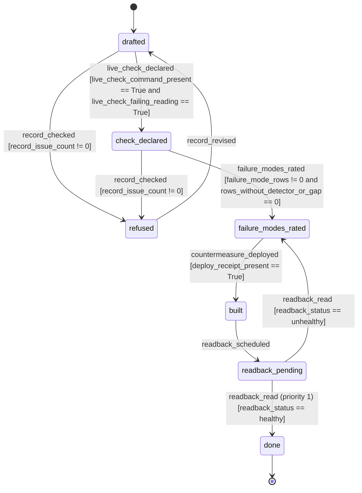
*Figure 6. The life of one design record. It renders the `state_machine` of the `node_design_process_reducer` contract (fragment below).*

<!-- contract-fragment: node_design_process_reducer:state_machine -->
```yaml
state_machine:
  version: {major: 1, minor: 0, patch: 0}
  state_machine_name: design_process_fsm
  state_machine_version: {major: 1, minor: 0, patch: 0}
  description: 'Lifecycle of one design record: a mechanism is done only when its live check was declared first and reads healthy after it is built and deployed.'
  initial_state: drafted
  terminal_states: [done]
  error_states: [refused]
  persistence_enabled: false
  states:
  - version: {major: 1, minor: 0, patch: 0}
    state_name: drafted
    state_type: operational
    description: The intended state is one measurable sentence.
  - version: {major: 1, minor: 0, patch: 0}
    state_name: check_declared
    state_type: operational
    description: The live check is declared and reads as a failing reading before the build.
  - version: {major: 1, minor: 0, patch: 0}
    state_name: failure_modes_rated
    state_type: operational
    description: Every failure mode has a detector or a named gap.
  - version: {major: 1, minor: 0, patch: 0}
    state_name: built
    state_type: operational
    description: The mechanism is merged and deployed.
  - version: {major: 1, minor: 0, patch: 0}
    state_name: readback_pending
    state_type: operational
    description: The live readback after deploy is waiting to be read.
  - version: {major: 1, minor: 0, patch: 0}
    state_name: done
    state_type: terminal
    description: The readback read healthy on the live system.
    is_terminal: true
    is_recoverable: false
  - version: {major: 1, minor: 0, patch: 0}
    state_name: refused
    state_type: error
    description: The design record checker refused the record; it returns to drafted after the fix.
  transitions:
  - version: {major: 1, minor: 0, patch: 0}
    transition_name: drafted_to_check_declared_on_live_check_declared
    from_state: drafted
    to_state: check_declared
    trigger: live_check_declared
    conditions:
    - {condition_name: check_command_present, condition_type: expression, expression: live_check_command_present == True}
    - {condition_name: check_fails_first, condition_type: expression, expression: live_check_failing_reading == True}
  - version: {major: 1, minor: 0, patch: 0}
    transition_name: drafted_to_refused_on_record_checked
    from_state: drafted
    to_state: refused
    trigger: record_checked
    conditions:
    - {condition_name: record_has_issue, condition_type: expression, expression: record_issue_count != 0}
  - version: {major: 1, minor: 0, patch: 0}
    transition_name: check_declared_to_refused_on_record_checked
    from_state: check_declared
    to_state: refused
    trigger: record_checked
    conditions:
    - {condition_name: record_has_issue, condition_type: expression, expression: record_issue_count != 0}
  - version: {major: 1, minor: 0, patch: 0}
    transition_name: refused_to_drafted_on_record_revised
    from_state: refused
    to_state: drafted
    trigger: record_revised
  - version: {major: 1, minor: 0, patch: 0}
    transition_name: check_declared_to_failure_modes_rated_on_failure_modes_rated
    from_state: check_declared
    to_state: failure_modes_rated
    trigger: failure_modes_rated
    conditions:
    - {condition_name: rows_exist, condition_type: expression, expression: failure_mode_rows != 0}
    - {condition_name: rows_covered, condition_type: expression, expression: rows_without_detector_or_gap == 0}
  - version: {major: 1, minor: 0, patch: 0}
    transition_name: failure_modes_rated_to_built_on_countermeasure_deployed
    from_state: failure_modes_rated
    to_state: built
    trigger: countermeasure_deployed
    conditions:
    - {condition_name: deploy_receipt, condition_type: expression, expression: deploy_receipt_present == True}
  - version: {major: 1, minor: 0, patch: 0}
    transition_name: built_to_readback_pending_on_readback_scheduled
    from_state: built
    to_state: readback_pending
    trigger: readback_scheduled
  - version: {major: 1, minor: 0, patch: 0}
    transition_name: readback_pending_to_done_on_readback_read
    from_state: readback_pending
    to_state: done
    trigger: readback_read
    priority: 1
    conditions:
    - {condition_name: healthy, condition_type: expression, expression: readback_status == healthy}
  - version: {major: 1, minor: 0, patch: 0}
    transition_name: readback_pending_to_failure_modes_rated_on_readback_unhealthy
    from_state: readback_pending
    to_state: failure_modes_rated
    trigger: readback_read
    conditions:
    - {condition_name: unhealthy, condition_type: expression, expression: readback_status == unhealthy}
```

<!-- diagram-contract: node_failure_record_reducer:state_machine -->
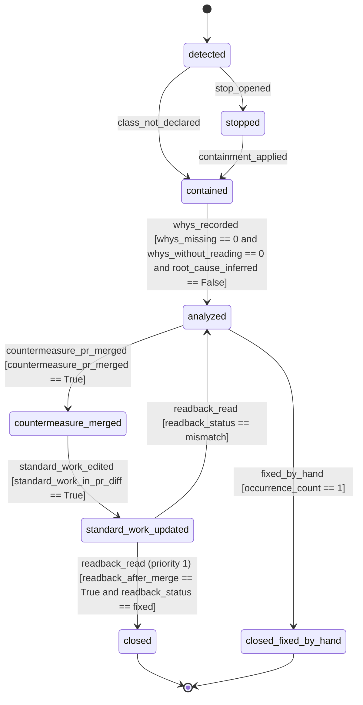
*Figure 7. The life of one failure record. It renders the `state_machine` of the `node_failure_record_reducer` contract (fragment below).*

<!-- contract-fragment: node_failure_record_reducer:state_machine -->
```yaml
state_machine:
  version: {major: 1, minor: 0, patch: 0}
  state_machine_name: failure_process_fsm
  state_machine_version: {major: 1, minor: 0, patch: 0}
  description: 'Lifecycle of one failure record: detect, stop, contain, five whys with a reading each, countermeasure as code, standard work, readback.'
  initial_state: detected
  terminal_states: [closed, closed_fixed_by_hand]
  error_states: []
  persistence_enabled: false
  states:
  - version: {major: 1, minor: 0, patch: 0}
    state_name: detected
    state_type: operational
    description: A detector read a defect of a declared class.
  - version: {major: 1, minor: 0, patch: 0}
    state_name: stopped
    state_type: operational
    description: New work into the class stopped (the andon stop is open).
  - version: {major: 1, minor: 0, patch: 0}
    state_name: contained
    state_type: operational
    description: The class's lanes and PRs are held, or the host or engine is set aside.
  - version: {major: 1, minor: 0, patch: 0}
    state_name: analyzed
    state_type: operational
    description: Five whys are recorded, each with the command that read it, and the root cause is not inferred.
  - version: {major: 1, minor: 0, patch: 0}
    state_name: countermeasure_merged
    state_type: operational
    description: A countermeasure merged as code (a hook, check, node or contract field).
  - version: {major: 1, minor: 0, patch: 0}
    state_name: standard_work_updated
    state_type: operational
    description: The skill, brief template or ruling the change touches is edited in the same PR.
  - version: {major: 1, minor: 0, patch: 0}
    state_name: closed
    state_type: terminal
    description: The readback read fixed after the merge.
    is_terminal: true
    is_recoverable: false
  - version: {major: 1, minor: 0, patch: 0}
    state_name: closed_fixed_by_hand
    state_type: terminal
    description: First occurrence fixed by hand; a second occurrence forces code.
    is_terminal: true
    is_recoverable: false
  transitions:
  - version: {major: 1, minor: 0, patch: 0}
    transition_name: detected_to_stopped_on_stop_opened
    from_state: detected
    to_state: stopped
    trigger: stop_opened
  - version: {major: 1, minor: 0, patch: 0}
    transition_name: detected_to_contained_on_class_not_declared
    from_state: detected
    to_state: contained
    trigger: class_not_declared
  - version: {major: 1, minor: 0, patch: 0}
    transition_name: stopped_to_contained_on_containment_applied
    from_state: stopped
    to_state: contained
    trigger: containment_applied
  - version: {major: 1, minor: 0, patch: 0}
    transition_name: contained_to_analyzed_on_whys_recorded
    from_state: contained
    to_state: analyzed
    trigger: whys_recorded
    conditions:
    - {condition_name: whys_complete, condition_type: expression, expression: whys_missing == 0}
    - {condition_name: whys_read, condition_type: expression, expression: whys_without_reading == 0}
    - {condition_name: root_cause_read, condition_type: expression, expression: root_cause_inferred == False}
  - version: {major: 1, minor: 0, patch: 0}
    transition_name: analyzed_to_closed_fixed_by_hand_on_fixed_by_hand
    from_state: analyzed
    to_state: closed_fixed_by_hand
    trigger: fixed_by_hand
    conditions:
    - {condition_name: first_occurrence, condition_type: expression, expression: occurrence_count == 1}
  - version: {major: 1, minor: 0, patch: 0}
    transition_name: analyzed_to_countermeasure_merged_on_countermeasure_pr_merged
    from_state: analyzed
    to_state: countermeasure_merged
    trigger: countermeasure_pr_merged
    conditions:
    - {condition_name: pr_merged, condition_type: expression, expression: countermeasure_pr_merged == True}
  - version: {major: 1, minor: 0, patch: 0}
    transition_name: countermeasure_merged_to_standard_work_updated_on_standard_work_edited
    from_state: countermeasure_merged
    to_state: standard_work_updated
    trigger: standard_work_edited
    conditions:
    - {condition_name: in_diff, condition_type: expression, expression: standard_work_in_pr_diff == True}
  - version: {major: 1, minor: 0, patch: 0}
    transition_name: standard_work_updated_to_closed_on_readback_read
    from_state: standard_work_updated
    to_state: closed
    trigger: readback_read
    priority: 1
    conditions:
    - {condition_name: after_merge, condition_type: expression, expression: readback_after_merge == True}
    - {condition_name: fixed, condition_type: expression, expression: readback_status == fixed}
  - version: {major: 1, minor: 0, patch: 0}
    transition_name: standard_work_updated_to_analyzed_on_readback_mismatch
    from_state: standard_work_updated
    to_state: analyzed
    trigger: readback_read
    conditions:
    - {condition_name: mismatch, condition_type: expression, expression: readback_status == mismatch}
```

<!-- contract-fragment: node_andon_stop_reducer:state_machine -->
```yaml
state_machine:
  version: {major: 1, minor: 0, patch: 0}
  state_machine_name: andon_stop_fsm
  state_machine_version: {major: 1, minor: 0, patch: 0}
  description: 'Lifecycle of one stop: opened by a detector, worked by one swarm lane under a lease, cleared only by consecutive complete fixed readbacks.'
  initial_state: open
  terminal_states: [cleared, declared_false]
  error_states: []
  persistence_enabled: false
  states:
  - version: {major: 1, minor: 0, patch: 0}
    state_name: open
    state_type: operational
    description: A detector found a defect of a declared class; no swarm lane holds the lease yet.
  - version: {major: 1, minor: 0, patch: 0}
    state_name: swarming
    state_type: operational
    description: One swarm lane holds the lease and works the cause.
  - version: {major: 1, minor: 0, patch: 0}
    state_name: fixed
    state_type: operational
    description: A countermeasure merged; the readback must read fixed on consecutive complete readings.
  - version: {major: 1, minor: 0, patch: 0}
    state_name: stale
    state_type: operational
    description: No live swarm lane past the stale limit, or the lease replacements are used up; one decision row is open.
  - version: {major: 1, minor: 0, patch: 0}
    state_name: cleared
    state_type: terminal
    description: The readback read fixed on the required consecutive readings; dispatch resumes.
    is_terminal: true
    is_recoverable: false
  - version: {major: 1, minor: 0, patch: 0}
    state_name: declared_false
    state_type: terminal
    description: The operator declared the stop a false positive; one decision row records it.
    is_terminal: true
    is_recoverable: false
  transitions:
  - version: {major: 1, minor: 0, patch: 0}
    transition_name: open_to_swarming_on_lease_granted
    from_state: open
    to_state: swarming
    trigger: lease_granted
    conditions:
    - {condition_name: replacement_budget_left, condition_type: expression, expression: lease_replacements_remaining != 0}
    actions:
    - version: {major: 1, minor: 0, patch: 0}
      action_name: emit_lease_record
      action_type: intent_emission
  - version: {major: 1, minor: 0, patch: 0}
    transition_name: stale_to_swarming_on_lease_granted
    from_state: stale
    to_state: swarming
    trigger: lease_granted
    conditions:
    - {condition_name: replacement_budget_left, condition_type: expression, expression: lease_replacements_remaining != 0}
    actions:
    - version: {major: 1, minor: 0, patch: 0}
      action_name: emit_lease_record
      action_type: intent_emission
  - version: {major: 1, minor: 0, patch: 0}
    transition_name: swarming_to_swarming_on_lease_expired_replaced
    from_state: swarming
    to_state: swarming
    trigger: lease_expired
    priority: 1
    conditions:
    - {condition_name: replacement_left, condition_type: expression, expression: lease_replacements_remaining != 0}
    actions:
    - version: {major: 1, minor: 0, patch: 0}
      action_name: emit_lease_record
      action_type: intent_emission
  - version: {major: 1, minor: 0, patch: 0}
    transition_name: swarming_to_stale_on_lease_expired_exhausted
    from_state: swarming
    to_state: stale
    trigger: lease_expired
    conditions:
    - {condition_name: replacements_used_up, condition_type: expression, expression: lease_replacements_remaining == 0}
    actions:
    - version: {major: 1, minor: 0, patch: 0}
      action_name: emit_decision_row
      action_type: intent_emission
  - version: {major: 1, minor: 0, patch: 0}
    transition_name: open_to_stale_on_stale_limit_reached
    from_state: open
    to_state: stale
    trigger: stale_limit_reached
    actions:
    - version: {major: 1, minor: 0, patch: 0}
      action_name: emit_decision_row
      action_type: intent_emission
  - version: {major: 1, minor: 0, patch: 0}
    transition_name: open_to_fixed_on_countermeasure_merged
    from_state: open
    to_state: fixed
    trigger: countermeasure_merged
  - version: {major: 1, minor: 0, patch: 0}
    transition_name: swarming_to_fixed_on_countermeasure_merged
    from_state: swarming
    to_state: fixed
    trigger: countermeasure_merged
  - version: {major: 1, minor: 0, patch: 0}
    transition_name: stale_to_fixed_on_countermeasure_merged
    from_state: stale
    to_state: fixed
    trigger: countermeasure_merged
  - version: {major: 1, minor: 0, patch: 0}
    transition_name: open_to_fixed_on_hand_fix_recorded
    from_state: open
    to_state: fixed
    trigger: hand_fix_recorded
    conditions:
    - {condition_name: hand_fix_allowed, condition_type: expression, expression: hand_fix_allowed == True}
  - version: {major: 1, minor: 0, patch: 0}
    transition_name: swarming_to_fixed_on_hand_fix_recorded
    from_state: swarming
    to_state: fixed
    trigger: hand_fix_recorded
    conditions:
    - {condition_name: hand_fix_allowed, condition_type: expression, expression: hand_fix_allowed == True}
  - version: {major: 1, minor: 0, patch: 0}
    transition_name: stale_to_fixed_on_hand_fix_recorded
    from_state: stale
    to_state: fixed
    trigger: hand_fix_recorded
    conditions:
    - {condition_name: hand_fix_allowed, condition_type: expression, expression: hand_fix_allowed == True}
  - version: {major: 1, minor: 0, patch: 0}
    transition_name: stale_to_stale_on_replacements_extended
    from_state: stale
    to_state: stale
    trigger: replacements_extended
    actions:
    - version: {major: 1, minor: 0, patch: 0}
      action_name: emit_decision_row
      action_type: intent_emission
  - version: {major: 1, minor: 0, patch: 0}
    transition_name: fixed_to_cleared_on_readback_fixed_enough
    from_state: fixed
    to_state: cleared
    trigger: readback_fixed
    priority: 1
    conditions:
    - {condition_name: readback_complete, condition_type: expression, expression: readback_complete == True}
    - {condition_name: no_fixed_readings_missing, condition_type: expression, expression: fixed_readings_missing == 0}
    actions:
    - version: {major: 1, minor: 0, patch: 0}
      action_name: emit_clear_record
      action_type: intent_emission
  - version: {major: 1, minor: 0, patch: 0}
    transition_name: fixed_to_fixed_on_readback_fixed_more_needed
    from_state: fixed
    to_state: fixed
    trigger: readback_fixed
    conditions:
    - {condition_name: fixed_readings_missing, condition_type: expression, expression: fixed_readings_missing != 0}
  - version: {major: 1, minor: 0, patch: 0}
    transition_name: fixed_to_fixed_on_readback_unknown
    from_state: fixed
    to_state: fixed
    trigger: readback_unknown
  - version: {major: 1, minor: 0, patch: 0}
    transition_name: fixed_to_open_on_readback_mismatch
    from_state: fixed
    to_state: open
    trigger: readback_mismatch
  - version: {major: 1, minor: 0, patch: 0}
    transition_name: fixed_to_stale_on_stale_limit_reached
    from_state: fixed
    to_state: stale
    trigger: stale_limit_reached
    actions:
    - version: {major: 1, minor: 0, patch: 0}
      action_name: emit_decision_row
      action_type: intent_emission
  - version: {major: 1, minor: 0, patch: 0}
    transition_name: open_to_declared_false_on_declared_false
    from_state: open
    to_state: declared_false
    trigger: declared_false
    actions:
    - version: {major: 1, minor: 0, patch: 0}
      action_name: emit_decision_row
      action_type: intent_emission
  - version: {major: 1, minor: 0, patch: 0}
    transition_name: swarming_to_declared_false_on_declared_false
    from_state: swarming
    to_state: declared_false
    trigger: declared_false
    actions:
    - version: {major: 1, minor: 0, patch: 0}
      action_name: emit_decision_row
      action_type: intent_emission
  - version: {major: 1, minor: 0, patch: 0}
    transition_name: fixed_to_declared_false_on_declared_false
    from_state: fixed
    to_state: declared_false
    trigger: declared_false
    actions:
    - version: {major: 1, minor: 0, patch: 0}
      action_name: emit_decision_row
      action_type: intent_emission
  - version: {major: 1, minor: 0, patch: 0}
    transition_name: stale_to_declared_false_on_declared_false
    from_state: stale
    to_state: declared_false
    trigger: declared_false
    actions:
    - version: {major: 1, minor: 0, patch: 0}
      action_name: emit_decision_row
      action_type: intent_emission
```

<!-- contract-fragment: node_wip_gate_reducer:state_machine -->
```yaml
state_machine:
  version: {major: 1, minor: 0, patch: 0}
  state_machine_name: wip_gate_fsm
  state_machine_version: {major: 1, minor: 0, patch: 0}
  description: 'Decision on one PR-opening dispatch request: admit, warn or refuse, from a repository''s open-PR count against its limit.'
  initial_state: requested
  terminal_states: [admitted, admitted_exempt, admitted_override, warned, refused]
  error_states: []
  persistence_enabled: false
  states:
  - version: {major: 1, minor: 0, patch: 0}
    state_name: requested
    state_type: operational
    description: A PR-opening dispatch asks to enter a repository.
  - version: {major: 1, minor: 0, patch: 0}
    state_name: admitted
    state_type: terminal
    description: The repository is under its limit.
    is_terminal: true
    is_recoverable: false
  - version: {major: 1, minor: 0, patch: 0}
    state_name: admitted_exempt
    state_type: terminal
    description: The dispatch reduces work in progress and its exemption validated.
    is_terminal: true
    is_recoverable: false
  - version: {major: 1, minor: 0, patch: 0}
    state_name: admitted_override
    state_type: terminal
    description: The slot reducer chose a last-resort PR-opening item for an at-limit repository (the no-idle rule) and its dispatcher-written evidence validated; the audit counts it.
    is_terminal: true
    is_recoverable: false
  - version: {major: 1, minor: 0, patch: 0}
    state_name: warned
    state_type: terminal
    description: Enforcement is off, or the reading is unusable and enforcement is off; the dispatch proceeds and the line prints the warning.
    is_terminal: true
    is_recoverable: false
  - version: {major: 1, minor: 0, patch: 0}
    state_name: refused
    state_type: terminal
    description: Enforcement is on and the repository is at its limit or its reading is unusable; the fill diverts the slot.
    is_terminal: true
    is_recoverable: false
  transitions:
  - version: {major: 1, minor: 0, patch: 0}
    transition_name: requested_to_admitted_override_on_facts_evaluated
    from_state: requested
    to_state: admitted_override
    trigger: facts_evaluated
    priority: 6
    conditions:
    - {condition_name: override_valid, condition_type: expression, expression: override_valid == True}
    - {condition_name: reading_usable, condition_type: expression, expression: reading_usable == True}
  - version: {major: 1, minor: 0, patch: 0}
    transition_name: requested_to_admitted_exempt_on_facts_evaluated
    from_state: requested
    to_state: admitted_exempt
    trigger: facts_evaluated
    priority: 5
    conditions:
    - {condition_name: exemption_valid, condition_type: expression, expression: exemption_valid == True}
  - version: {major: 1, minor: 0, patch: 0}
    transition_name: requested_to_refused_on_facts_evaluated_unusable
    from_state: requested
    to_state: refused
    trigger: facts_evaluated
    priority: 4
    conditions:
    - {condition_name: reading_unusable, condition_type: expression, expression: reading_usable == False}
    - {condition_name: enforcing, condition_type: expression, expression: enforcement_on == True}
  - version: {major: 1, minor: 0, patch: 0}
    transition_name: requested_to_warned_on_facts_evaluated_unusable
    from_state: requested
    to_state: warned
    trigger: facts_evaluated
    priority: 3
    conditions:
    - {condition_name: reading_unusable, condition_type: expression, expression: reading_usable == False}
  - version: {major: 1, minor: 0, patch: 0}
    transition_name: requested_to_admitted_on_facts_evaluated
    from_state: requested
    to_state: admitted
    trigger: facts_evaluated
    priority: 2
    conditions:
    - {condition_name: under_limit, condition_type: expression, expression: repo_under_limit == True}
  - version: {major: 1, minor: 0, patch: 0}
    transition_name: requested_to_refused_on_facts_evaluated_at_limit
    from_state: requested
    to_state: refused
    trigger: facts_evaluated
    priority: 1
    conditions:
    - {condition_name: enforcing, condition_type: expression, expression: enforcement_on == True}
  - version: {major: 1, minor: 0, patch: 0}
    transition_name: requested_to_warned_on_facts_evaluated_at_limit
    from_state: requested
    to_state: warned
    trigger: facts_evaluated
```

<!-- contract-fragment: node_slot_assignment_reducer:state_machine -->
```yaml
state_machine:
  version: {major: 1, minor: 0, patch: 0}
  state_machine_name: slot_assignment_fsm
  state_machine_version: {major: 1, minor: 0, patch: 0}
  description: What one free lab slot takes, in pull-first order; the only way to stay empty is to have no candidate of any kind, never a WIP limit.
  initial_state: free
  terminal_states: [assigned_cause, assigned_lander, assigned_open_pr_work, assigned_backlog, assigned_non_pr_work, assigned_override, empty_no_candidates]
  error_states: [empty_no_candidates]
  persistence_enabled: false
  states:
  - version: {major: 1, minor: 0, patch: 0}
    state_name: free
    state_type: operational
    description: A lab slot is free and the fill is choosing its work.
  - version: {major: 1, minor: 0, patch: 0}
    state_name: assigned_cause
    state_type: terminal
    description: 'Category 1: the cause of a stopped class.'
    is_terminal: true
    is_recoverable: false
  - version: {major: 1, minor: 0, patch: 0}
    state_name: assigned_lander
    state_type: terminal
    description: 'Category 2: a missing lander or an unowned shared red.'
    is_terminal: true
    is_recoverable: false
  - version: {major: 1, minor: 0, patch: 0}
    state_name: assigned_open_pr_work
    state_type: terminal
    description: 'Category 3: work on an open unlanded PR (fix, land or review).'
    is_terminal: true
    is_recoverable: false
  - version: {major: 1, minor: 0, patch: 0}
    state_name: assigned_backlog
    state_type: terminal
    description: 'Category 4: a backlog item in a repository under its limit.'
    is_terminal: true
    is_recoverable: false
  - version: {major: 1, minor: 0, patch: 0}
    state_name: assigned_non_pr_work
    state_type: terminal
    description: 'Category 5: work that opens no PR (tests, bug triage, readback, delegation proof, experiment).'
    is_terminal: true
    is_recoverable: false
  - version: {major: 1, minor: 0, patch: 0}
    state_name: assigned_override
    state_type: terminal
    description: 'Category 6: a PR-opening item in an at-limit repository because nothing else exists; prints the idle finding.'
    is_terminal: true
    is_recoverable: false
  - version: {major: 1, minor: 0, patch: 0}
    state_name: empty_no_candidates
    state_type: error
    description: No candidate of any category exists.
    is_terminal: true
    is_recoverable: false
  transitions:
  - version: {major: 1, minor: 0, patch: 0}
    transition_name: free_to_assigned_cause_on_candidates_evaluated
    from_state: free
    to_state: assigned_cause
    trigger: candidates_evaluated
    priority: 6
    conditions:
    - {condition_name: has_cause, condition_type: expression, expression: stopped_cause_items != 0}
  - version: {major: 1, minor: 0, patch: 0}
    transition_name: free_to_assigned_lander_on_candidates_evaluated
    from_state: free
    to_state: assigned_lander
    trigger: candidates_evaluated
    priority: 5
    conditions:
    - {condition_name: has_lander, condition_type: expression, expression: lander_items != 0}
  - version: {major: 1, minor: 0, patch: 0}
    transition_name: free_to_assigned_open_pr_work_on_candidates_evaluated
    from_state: free
    to_state: assigned_open_pr_work
    trigger: candidates_evaluated
    priority: 4
    conditions:
    - {condition_name: has_open_pr_work, condition_type: expression, expression: open_pr_work_items != 0}
  - version: {major: 1, minor: 0, patch: 0}
    transition_name: free_to_assigned_backlog_on_candidates_evaluated
    from_state: free
    to_state: assigned_backlog
    trigger: candidates_evaluated
    priority: 3
    conditions:
    - {condition_name: has_backlog_under_limit, condition_type: expression, expression: backlog_items_under_limit != 0}
  - version: {major: 1, minor: 0, patch: 0}
    transition_name: free_to_assigned_non_pr_work_on_candidates_evaluated
    from_state: free
    to_state: assigned_non_pr_work
    trigger: candidates_evaluated
    priority: 2
    conditions:
    - {condition_name: has_non_pr_work, condition_type: expression, expression: non_pr_work_items != 0}
  - version: {major: 1, minor: 0, patch: 0}
    transition_name: free_to_assigned_override_on_candidates_evaluated
    from_state: free
    to_state: assigned_override
    trigger: candidates_evaluated
    priority: 1
    conditions:
    - {condition_name: has_backlog_at_limit, condition_type: expression, expression: backlog_items_at_limit != 0}
  - version: {major: 1, minor: 0, patch: 0}
    transition_name: free_to_empty_no_candidates_on_candidates_evaluated
    from_state: free
    to_state: empty_no_candidates
    trigger: candidates_evaluated
    conditions:
    - {condition_name: no_candidates, condition_type: expression, expression: candidates_total == 0}
```

<!-- diagram-contract: node_delivery_path_reducer:state_machine -->
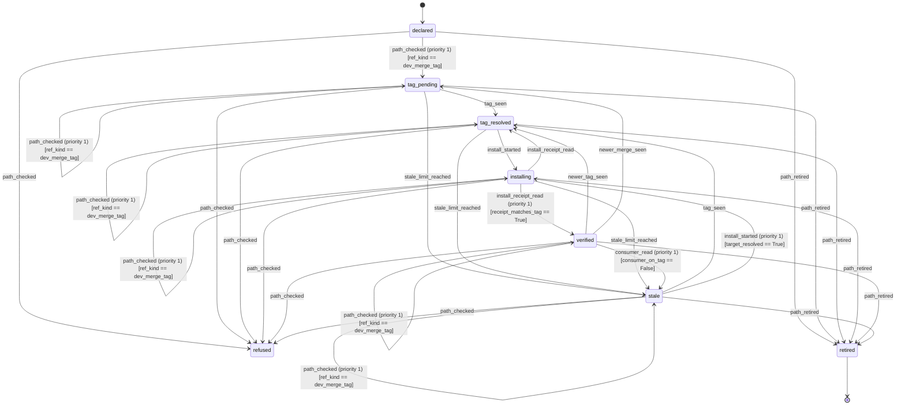
*Figure 11. The life of one delivery path. It renders the `state_machine` of the `node_delivery_path_reducer` contract (fragment below). A path that reads anything but a dev-merge tag is `refused` from every active state; a path whose expected tag never appears, whose install does not match by the limit or whose consumer drifted off the tag is `stale`, and a late tag brings a stale path back.*

<!-- contract-fragment: node_delivery_path_reducer:state_machine -->
```yaml
state_machine:
  version: {major: 1, minor: 0, patch: 0}
  state_machine_name: delivery_path_fsm
  state_machine_version: {major: 1, minor: 0, patch: 0}
  description: 'Lifecycle of one delivery path: an artifact reaches its consumer only from a dev-merge tag, and a path that reads anything else is refused.'
  initial_state: declared
  terminal_states: [retired]
  error_states: [refused]
  persistence_enabled: false
  states:
  - version: {major: 1, minor: 0, patch: 0}
    state_name: declared
    state_type: operational
    description: The delivery path is registered in the delivery contract with its repository, artifact, consumer and tag pattern.
  - version: {major: 1, minor: 0, patch: 0}
    state_name: tag_pending
    state_type: operational
    description: The path reads a dev-merge tag and waits for the release train to publish the tag of the newest merge.
  - version: {major: 1, minor: 0, patch: 0}
    state_name: tag_resolved
    state_type: operational
    description: The newest dev-merge tag is read and the consumer is not yet on it.
  - version: {major: 1, minor: 0, patch: 0}
    state_name: installing
    state_type: operational
    description: The consumer is being installed from the resolved tag.
  - version: {major: 1, minor: 0, patch: 0}
    state_name: verified
    state_type: operational
    description: The consumer's installed receipt names the resolved tag.
  - version: {major: 1, minor: 0, patch: 0}
    state_name: stale
    state_type: operational
    description: The tag did not appear or the install did not match past the configured limit, or the consumer was found off the tag (stale at once, with no wait); one decision row is written.
  - version: {major: 1, minor: 0, patch: 0}
    state_name: retired
    state_type: terminal
    description: The path was removed from the delivery contract.
    is_terminal: true
    is_recoverable: false
  - version: {major: 1, minor: 0, patch: 0}
    state_name: refused
    state_type: error
    description: The path reads a branch, a sha, a hand-kept version or a bump pull request, and is refused until a new path is declared.
  transitions:
  - version: {major: 1, minor: 0, patch: 0}
    transition_name: declared_to_tag_pending_on_path_checked_valid
    from_state: declared
    to_state: tag_pending
    trigger: path_checked
    priority: 1
    conditions:
    - {condition_name: ref_is_dev_merge_tag, condition_type: expression, expression: ref_kind == dev_merge_tag}
  - version: {major: 1, minor: 0, patch: 0}
    transition_name: declared_to_refused_on_path_checked_refused
    from_state: declared
    to_state: refused
    trigger: path_checked
  - version: {major: 1, minor: 0, patch: 0}
    transition_name: tag_pending_to_tag_resolved_on_tag_seen
    from_state: tag_pending
    to_state: tag_resolved
    trigger: tag_seen
  - version: {major: 1, minor: 0, patch: 0}
    transition_name: tag_pending_to_stale_on_stale_limit_reached
    from_state: tag_pending
    to_state: stale
    trigger: stale_limit_reached
  - version: {major: 1, minor: 0, patch: 0}
    transition_name: tag_pending_to_tag_pending_on_path_checked_valid
    from_state: tag_pending
    to_state: tag_pending
    trigger: path_checked
    priority: 1
    conditions:
    - {condition_name: ref_is_dev_merge_tag, condition_type: expression, expression: ref_kind == dev_merge_tag}
  - version: {major: 1, minor: 0, patch: 0}
    transition_name: tag_pending_to_refused_on_path_checked_refused
    from_state: tag_pending
    to_state: refused
    trigger: path_checked
  - version: {major: 1, minor: 0, patch: 0}
    transition_name: tag_resolved_to_installing_on_install_started
    from_state: tag_resolved
    to_state: installing
    trigger: install_started
  - version: {major: 1, minor: 0, patch: 0}
    transition_name: tag_resolved_to_stale_on_stale_limit_reached
    from_state: tag_resolved
    to_state: stale
    trigger: stale_limit_reached
  - version: {major: 1, minor: 0, patch: 0}
    transition_name: tag_resolved_to_tag_resolved_on_path_checked_valid
    from_state: tag_resolved
    to_state: tag_resolved
    trigger: path_checked
    priority: 1
    conditions:
    - {condition_name: ref_is_dev_merge_tag, condition_type: expression, expression: ref_kind == dev_merge_tag}
  - version: {major: 1, minor: 0, patch: 0}
    transition_name: tag_resolved_to_refused_on_path_checked_refused
    from_state: tag_resolved
    to_state: refused
    trigger: path_checked
  - version: {major: 1, minor: 0, patch: 0}
    transition_name: installing_to_verified_on_install_receipt_read
    from_state: installing
    to_state: verified
    trigger: install_receipt_read
    priority: 1
    conditions:
    - {condition_name: receipt_names_tag, condition_type: expression, expression: receipt_matches_tag == True}
  - version: {major: 1, minor: 0, patch: 0}
    transition_name: installing_to_tag_resolved_on_install_receipt_read_mismatch
    from_state: installing
    to_state: tag_resolved
    trigger: install_receipt_read
  - version: {major: 1, minor: 0, patch: 0}
    transition_name: installing_to_stale_on_stale_limit_reached
    from_state: installing
    to_state: stale
    trigger: stale_limit_reached
  - version: {major: 1, minor: 0, patch: 0}
    transition_name: installing_to_installing_on_path_checked_valid
    from_state: installing
    to_state: installing
    trigger: path_checked
    priority: 1
    conditions:
    - {condition_name: ref_is_dev_merge_tag, condition_type: expression, expression: ref_kind == dev_merge_tag}
  - version: {major: 1, minor: 0, patch: 0}
    transition_name: installing_to_refused_on_path_checked_refused
    from_state: installing
    to_state: refused
    trigger: path_checked
  - version: {major: 1, minor: 0, patch: 0}
    transition_name: verified_to_tag_resolved_on_newer_tag_seen
    from_state: verified
    to_state: tag_resolved
    trigger: newer_tag_seen
  - version: {major: 1, minor: 0, patch: 0}
    transition_name: verified_to_tag_pending_on_newer_merge_seen
    from_state: verified
    to_state: tag_pending
    trigger: newer_merge_seen
  - version: {major: 1, minor: 0, patch: 0}
    transition_name: verified_to_stale_on_consumer_read_off_tag
    from_state: verified
    to_state: stale
    trigger: consumer_read
    priority: 1
    conditions:
    - {condition_name: consumer_off_tag, condition_type: expression, expression: consumer_on_tag == False}
  - version: {major: 1, minor: 0, patch: 0}
    transition_name: verified_to_verified_on_consumer_read_on_tag
    from_state: verified
    to_state: verified
    trigger: consumer_read
  - version: {major: 1, minor: 0, patch: 0}
    transition_name: verified_to_verified_on_path_checked_valid
    from_state: verified
    to_state: verified
    trigger: path_checked
    priority: 1
    conditions:
    - {condition_name: ref_is_dev_merge_tag, condition_type: expression, expression: ref_kind == dev_merge_tag}
  - version: {major: 1, minor: 0, patch: 0}
    transition_name: verified_to_refused_on_path_checked_refused
    from_state: verified
    to_state: refused
    trigger: path_checked
  - version: {major: 1, minor: 0, patch: 0}
    transition_name: stale_to_tag_resolved_on_tag_seen
    from_state: stale
    to_state: tag_resolved
    trigger: tag_seen
  - version: {major: 1, minor: 0, patch: 0}
    transition_name: stale_to_installing_on_install_started
    from_state: stale
    to_state: installing
    trigger: install_started
    priority: 1
    conditions:
    - {condition_name: target_resolved, condition_type: expression, expression: target_resolved == True}
  - version: {major: 1, minor: 0, patch: 0}
    transition_name: stale_to_stale_on_path_checked_valid
    from_state: stale
    to_state: stale
    trigger: path_checked
    priority: 1
    conditions:
    - {condition_name: ref_is_dev_merge_tag, condition_type: expression, expression: ref_kind == dev_merge_tag}
  - version: {major: 1, minor: 0, patch: 0}
    transition_name: stale_to_refused_on_path_checked_refused
    from_state: stale
    to_state: refused
    trigger: path_checked
  - version: {major: 1, minor: 0, patch: 0}
    transition_name: declared_to_retired_on_path_retired
    from_state: declared
    to_state: retired
    trigger: path_retired
  - version: {major: 1, minor: 0, patch: 0}
    transition_name: tag_pending_to_retired_on_path_retired
    from_state: tag_pending
    to_state: retired
    trigger: path_retired
  - version: {major: 1, minor: 0, patch: 0}
    transition_name: tag_resolved_to_retired_on_path_retired
    from_state: tag_resolved
    to_state: retired
    trigger: path_retired
  - version: {major: 1, minor: 0, patch: 0}
    transition_name: installing_to_retired_on_path_retired
    from_state: installing
    to_state: retired
    trigger: path_retired
  - version: {major: 1, minor: 0, patch: 0}
    transition_name: verified_to_retired_on_path_retired
    from_state: verified
    to_state: retired
    trigger: path_retired
  - version: {major: 1, minor: 0, patch: 0}
    transition_name: stale_to_retired_on_path_retired
    from_state: stale
    to_state: retired
    trigger: path_retired
```

<!-- diagram-contract: node_delegation_seam_orchestrator:graph -->
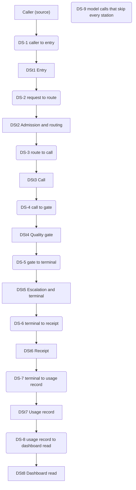
*Figure 8. The delegation line, every station and every seam reading, and the leak. It renders the `execution_graph` of the `node_delegation_seam_orchestrator` contract (the fragment below).*

<!-- contract-fragment: node_delegation_seam_orchestrator:graph -->
```yaml
workflow_coordination:
  workflow_definition:
    workflow_metadata:
      workflow_name: delegation_line_seam_read
      workflow_version: {major: 1, minor: 0, patch: 0}
      description: Read every seam of the delegation line from caller to dashboard read, and the leak.
    execution_graph:
      nodes:
      - {node_id: caller, node_type: EFFECT_GENERIC, description: Caller (source)}
      - node_id: ds_1_caller_to_entry
        node_type: COMPUTE_GENERIC
        description: DS-1 caller to entry
        depends_on: [caller]
        step_config: {operation: classify_ds_1, shape: ModelDelegateSkillRequest}
      - node_id: dst1_entry
        node_type: EFFECT_GENERIC
        description: DSt1 Entry
        depends_on: [ds_1_caller_to_entry]
      - node_id: ds_2_request_to_route
        node_type: COMPUTE_GENERIC
        description: DS-2 request to route
        depends_on: [dst1_entry]
        step_config: {operation: classify_ds_2, shape: ModelRoutingDecision}
      - node_id: dst2_routing
        node_type: EFFECT_GENERIC
        description: DSt2 Admission and routing
        depends_on: [ds_2_request_to_route]
      - node_id: ds_3_route_to_call
        node_type: COMPUTE_GENERIC
        description: DS-3 route to call
        depends_on: [dst2_routing]
        step_config: {operation: classify_ds_3, gap: D-GAP-8}
      - node_id: dst3_call
        node_type: EFFECT_GENERIC
        description: DSt3 Call
        depends_on: [ds_3_route_to_call]
      - node_id: ds_4_call_to_gate
        node_type: COMPUTE_GENERIC
        description: DS-4 call to gate
        depends_on: [dst3_call]
        step_config: {operation: classify_ds_4, shape: ModelQualityGateResult}
      - node_id: dst4_quality_gate
        node_type: EFFECT_GENERIC
        description: DSt4 Quality gate
        depends_on: [ds_4_call_to_gate]
      - node_id: ds_5_gate_to_terminal
        node_type: COMPUTE_GENERIC
        description: DS-5 gate to terminal
        depends_on: [dst4_quality_gate]
        step_config: {operation: classify_ds_5, shape: EnumDelegationTerminalFailureCause}
      - node_id: dst5_escalation_terminal
        node_type: EFFECT_GENERIC
        description: DSt5 Escalation and terminal
        depends_on: [ds_5_gate_to_terminal]
      - node_id: ds_6_terminal_to_receipt
        node_type: COMPUTE_GENERIC
        description: DS-6 terminal to receipt
        depends_on: [dst5_escalation_terminal]
        step_config: {operation: classify_ds_6, shape: ModelDelegateSkillResponse}
      - node_id: dst6_receipt
        node_type: EFFECT_GENERIC
        description: DSt6 Receipt
        depends_on: [ds_6_terminal_to_receipt]
      - node_id: ds_7_terminal_to_record
        node_type: COMPUTE_GENERIC
        description: DS-7 terminal to usage record
        depends_on: [dst6_receipt]
        step_config: {operation: classify_ds_7, shape: delegation_events}
      - node_id: dst7_usage_record
        node_type: EFFECT_GENERIC
        description: DSt7 Usage record
        depends_on: [ds_7_terminal_to_record]
      - node_id: ds_8_record_to_read
        node_type: COMPUTE_GENERIC
        description: DS-8 usage record to dashboard read
        depends_on: [dst7_usage_record]
        step_config: {operation: classify_ds_8, shape: api_contract.yaml}
      - node_id: dst8_dashboard_read
        node_type: EFFECT_GENERIC
        description: DSt8 Dashboard read
        depends_on: [ds_8_record_to_read]
      - node_id: ds_9_calls_that_skip_every_station
        node_type: COMPUTE_GENERIC
        description: DS-9 model calls that skip every station
        step_config: {operation: classify_ds_9, gap: D-GAP-7}
```
